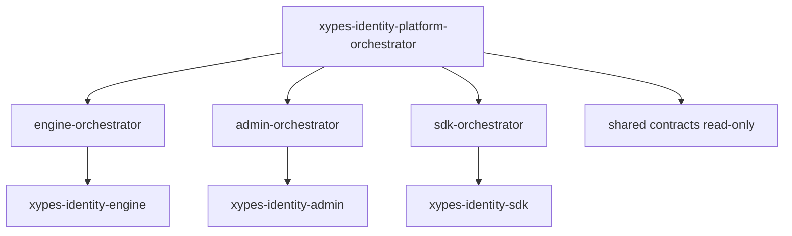

# Agent Architecture

## Goals

- Mirror the xypes pattern: a platform orchestrator at the root, repo-local orchestrators inside each repo, and durable context files that survive across sessions.
- Make every agent aware of the boundary it owns and the contracts it must respect.
- Prevent agents from flattening this workspace into a single mixed plan.

## Topology

## Roles

### Platform orchestrator

- Lives at: `./.github/agents/xypes-identity-platform-orchestrator.agent.md`
- Reads: `./xypes-identity-platform-context.json`, `./shared/ARCHITECTURE.md`, `./shared/ROADMAP.md`, each repo's `.github/agent-context.json`.
- Owns: cross-repo sequencing, contract changes, rollout strategy, and shared roadmap updates.
- Never edits repo internals directly.

### Engine orchestrator

- Lives at: `./xypes-identity-engine/.github/agents/engine-orchestrator.agent.md`
- Owns: authorization core, decision API, control plane, caches, outbox.
- Source of truth for authorization semantics.
- Must reject changes that would let other repos bypass authorization.

### Admin orchestrator

- Lives at: `./xypes-identity-admin/.github/agents/admin-orchestrator.agent.md`
- Owns: admin UI and admin API, governance workflows, access reviews, audit visibility.
- Must call the engine for authorization. Never enforces locally.

### SDK orchestrator

- Lives at: `./xypes-identity-sdk/.github/agents/sdk-orchestrator.agent.md`
- Owns: client SDKs, middleware, integration examples.
- Must surface engine semantics faithfully. Never invents policy.

## Routing Rules

1. Single-repo tasks go directly to that repo's local orchestrator.
2. Tasks that change a shared contract go to the platform orchestrator first.
3. Tasks that change authorization semantics always start with the engine.
4. Admin and SDK never lead a sequence that changes authorization behavior.
5. If a repo-local orchestrator is not available in the runtime, the platform orchestrator returns a fallback plan instead of pretending delegation succeeded.

## Default Sequence For Cross-Repo Work

1. Engine first
2. Admin second
3. SDK third
4. Cross-repo validation last

## Durable Context

- Platform-level durable notes: `./xypes-identity-platform-context.json`
- Repo-level durable notes: `./<repo>/.github/agent-context.json`
- Architecture and roadmap: `./shared/ARCHITECTURE.md`, `./shared/ROADMAP.md`
- Engineering rules: `./docs/DESIGN_GUIDELINES.md`
- Execution plan: `./docs/EXECUTION_PLAN.md`

## Why This Topology

- Authorization platforms fail when boundaries blur. Agents must respect the same boundaries the system does.
- A single mega-agent across all roots tends to merge admin convenience with authorization correctness. The split prevents that.
- Per-repo orchestrators allow domain-specific instructions without polluting the platform view.
