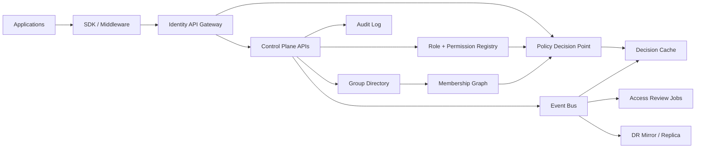

# Dynamic RBAC + Group Nesting Roadmap Review

## Executive Critique

The roadmap is directionally sound, but it mixes control-plane concerns, runtime authorization, and integration patterns without clearly separating them. That makes the design look simpler than it will be in production.

The biggest gaps are:

1. No hard tenant boundary model. If multiple applications can define roles dynamically, you need explicit isolation rules for names, ownership, policy scope, and query visibility.
2. No evaluation model. "Users -> Groups -> Roles -> Permissions" is incomplete without precedence, conflict resolution, inheritance limits, time-based access, and cycle handling for nested groups.
3. No distinction between identity data and authorization policy data. Group membership, role catalog, policy bindings, and audit history should not all evolve the same way.
4. JWT guidance is too optimistic. Embedding full role/group state into tokens works only for small, slow-changing graphs. Nested groups and deny rules usually require a runtime check or very short-lived derived claims.
5. Auditing is underspecified. Real governance needs actor, reason, ticket/reference, before/after state, approval workflow, and replayable events.
6. Caching is mentioned, but invalidation strategy is not. In RBAC systems, cache correctness is the hard part, especially when deny rules and nested groups exist.

## Improved Target Model

Split the platform into four layers:

1. Identity layer
   - Users, service principals, external identities, tenant mapping.
2. Directory layer
   - Groups, nested groups, ownership, membership lifecycle, import/sync jobs.
3. Authorization layer
   - Permissions, roles, role bindings, deny policies, evaluation engine.
4. Integration layer
   - APIs, SDKs, token enrichment, webhooks, event streams, caches.

Recommended core entities:

- `tenant`
- `application`
- `principal`
- `group`
- `group_membership`
- `permission`
- `role_definition`
- `role_binding`
- `policy_rule`
- `audit_event`
- `access_review`
- `decision_cache`

Recommended binding model:

- A role definition contains permissions.
- A binding attaches a role to a principal or group at a specific scope.
- Scopes should support at least `platform`, `tenant`, `application`, and `resource`.
- Deny should be explicit policy, not an attribute sprinkled onto roles.

## Improved Roadmap

### Phase 1: Domain and Boundary Definitions

1. Define tenancy model.
   - Single-tenant control plane or multi-tenant shared platform.
   - Global objects vs tenant objects vs application-local objects.
2. Define authorization semantics.
   - Allow/deny precedence.
   - Direct vs inherited membership.
   - Maximum nesting depth.
   - Cycle detection and prevention.
   - Staleness tolerance for caches and tokens.
3. Define scope model.
   - Role assignment at platform, tenant, application, and resource levels.

### Phase 2: Control Plane APIs

1. Role registry APIs.
   - Create versioned role definitions.
   - Mark roles as draft, active, deprecated, retired.
   - Require owner and application/tenant context.
2. Group directory APIs.
   - Create groups with owner, type, and scope.
   - Manage nested groups with cycle checks.
   - Support membership source: manual, synced, rule-based.
3. Binding APIs.
   - Bind roles to groups or principals with scope and optional conditions.

### Phase 3: Runtime Authorization Engine

1. Decision API.
   - `is_allowed(principal, action, resource, context)`
2. Explain API.
   - Return the chain that granted or denied access.
3. Effective access API.
   - Materialize all effective permissions for a principal within a scope.
4. Revocation model.
   - Fast-path invalidation for membership and policy changes.

### Phase 4: Governance and Safety Controls

1. Approval workflow for privileged role creation and assignment.
2. Immutable audit events with before/after payloads.
3. Access reviews for stale groups, stale bindings, and orphaned owners.
4. Separation-of-duties rules for toxic combinations.

### Phase 5: Scale and Operability

1. Event-driven recomputation of impacted principals.
2. Precomputed effective access for hot paths.
3. Regional replication and disaster recovery.
4. SLOs for decision latency, propagation delay, and audit durability.

## Reference Architecture

## What to Change in the Original Roadmap

Replace "roles map to permissions, groups map to users" with a more general graph:

- Principals can receive access directly or through groups.
- Groups can contain principals and groups.
- Roles are definitions only.
- Bindings attach roles to principals/groups at a scope.
- Policies can allow or deny.

Replace "use JWT claims or OAuth scopes to embed role/group info" with:

- Put stable identity claims in tokens.
- Optionally embed small, bounded authorization summaries.
- Use introspection or decision APIs for high-risk or deeply nested checks.

Replace "query effective permissions for a user" with two separate capabilities:

- authorization decision checks for runtime enforcement
- explain/effective-access endpoints for admin and debugging use cases

## Comparison With Other Systems

### Compared with classic enterprise RBAC

Classic RBAC is usually simpler:

- central role catalog
- direct user-role or group-role assignments
- little or no application-defined schema variation

Your roadmap is more flexible, but that flexibility adds platform risk. Without stricter scope and tenancy controls, application-defined roles become hard to govern.

### Compared with Google Zanzibar-style systems

Zanzibar-style systems model access as tuple relationships over resources, not only roles and groups. They are better when you need:

- very large relationship graphs
- fine-grained, resource-level sharing
- consistent global authorization checks

Your roadmap is easier to reason about for enterprise admin workflows, but weaker for document/object-level sharing unless you evolve role bindings into relationship tuples.

### Compared with Microsoft Entra ID / Azure RBAC

Azure-style RBAC is strong in scope hierarchy, deny assignments, management-plane governance, and auditability. Your roadmap overlaps with it conceptually, but is currently missing:

- strong scope hierarchy semantics
- privileged identity management patterns
- eligible vs active assignments
- review and approval workflows

### Compared with Keycloak

Keycloak is strong for identity federation, realm/client roles, and token issuance. It is weaker as a general-purpose nested-graph authorization engine. Your roadmap goes beyond Keycloak if you implement:

- deep nested groups
- runtime explainability
- event-driven recomputation
- rich audit and review workflows

### Compared with OPA / Cedar-based policy systems

OPA and Cedar separate policy evaluation from identity storage. They are strong when policy logic is complex and contextual. Your roadmap is more directory-centric. If your future access decisions depend on attributes like geography, time, record ownership, or risk score, you will likely need to combine RBAC with ABAC or ReBAC rather than rely on roles alone.

## Recommended Design Position

The safest evolution path is:

1. Start with scoped RBAC plus nested groups.
2. Model bindings explicitly instead of overloading roles.
3. Add deny and explain semantics early.
4. Keep tokens small and move authoritative decisions to the engine.
5. Leave room for ABAC/ReBAC later instead of locking the platform into role-only semantics.

That gives you something more governable than app-local role sprawl, while avoiding the immediate complexity of a full Zanzibar clone.