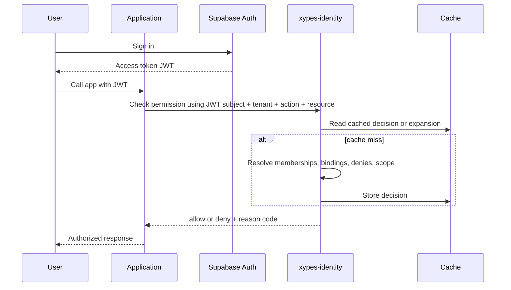

# Supabase Auth + Custom RBAC Engine

## Decision

Use Supabase for authentication and session management.

Build authorization separately inside xypes-identity.

That gives you fast delivery for sign-in, OAuth, password reset, email flows, and session issuance without forcing your SaaS authorization model into JWT claims.

## Boundary of Responsibility

### Supabase owns

- user authentication
- session lifecycle
- MFA and OAuth providers
- identity claims such as `sub`, `email`, `phone`, and auth provider metadata

### xypes-identity owns

- tenant membership
- applications and scopes
- groups and nested groups
- role definitions and versions
- role bindings
- deny policies
- effective permission evaluation
- audit logs and access reviews
- explainability for decisions

## Recommended Token Strategy

Keep the JWT small and stable.

Recommended claims:

- `sub`
- `session_id`
- `tenant_id` only if a single active tenant is selected
- `email`
- `auth_time`
- coarse flags only if stable, such as `is_platform_admin`

Do not embed:

- nested group membership
- dynamic application roles
- effective permissions
- deny rules
- full tenant entitlement sets

Those belong in the authorization engine because they change too often and need immediate revocation.

## Request Flow

## Runtime Model

Authorization should evaluate this graph:

- principal
- principal belongs to zero or more groups
- groups can contain groups
- groups or principals receive role bindings
- role definitions expand to permissions
- deny policies override allows at the same or broader scope

This is better than trying to derive access from JWT role arrays because it supports:

- dynamic roles per application
- tenant isolation
- immediate revocation
- scoped access
- explainability

## Minimum Service Interfaces

### Auth integration endpoint

- `POST /v1/auth/resolve-session`
- purpose: map JWT subject to internal principal and active tenant context

### Decision endpoint

- `POST /v1/authorize/check`
- input: principal, tenant, application, action, resource, context
- output: allow or deny, matched bindings, deny source, cache status

### Explain endpoint

- `POST /v1/authorize/explain`
- purpose: admin/debug path for why access was granted or denied

### Expansion endpoint

- `GET /v1/principals/:id/effective-access`
- purpose: review and troubleshooting, not hot-path app enforcement

## Data Ownership Model

Recommended split:

### Supabase tables

- auth users only
- optional profile table if needed for display metadata

### xypes-identity tables

- principals
- tenants
- tenant_memberships
- applications
- groups
- group_memberships
- role_definitions
- permissions
- role_permissions
- role_bindings
- deny_policies
- audit_events
- access_reviews

Use the Supabase user id as the external identity reference, not as the full authorization model.

## Tenant Model

For SaaS, treat tenant context as first-class.

Every sensitive operation should evaluate at least:

- who is acting
- which tenant they are acting in
- which application owns the role namespace
- what scope the permission applies to

Avoid global role names without tenant or application boundaries. `admin` is too ambiguous across customers.

## Caching Model

Use two caches:

1. Graph expansion cache
   - resolved memberships and inherited bindings
2. Decision cache
   - final `allow` or `deny` for a specific `(principal, tenant, action, resource-type, resource-id)` tuple when feasible

Invalidate on:

- group membership changes
- nested group changes
- role definition changes
- role binding changes
- deny policy changes
- tenant suspension or principal deactivation

Do not rely on JWT expiry for revocation.

## Event Model

Publish events for:

- principal added to group
- principal removed from group
- group nested into group
- role created or version promoted
- binding created or revoked
- deny policy changed

Consumers should:

- invalidate caches
- recompute affected expansions
- write audit events
- trigger access review signals when privileged access changes

## Where Supabase Helps and Where It Does Not

Supabase helps with:

- authentication UX
- identity provider integration
- session issuance
- basic user storage
- managed Postgres if you choose to colocate data

Supabase does not solve:

- nested group graph evaluation
- dynamic multi-app role registries
- permission explainability
- deny precedence
- SaaS access governance
- high-confidence revocation semantics

## Security Position

Recommended enforcement pattern:

1. Application verifies Supabase JWT.
2. Application extracts `sub` and active tenant context.
3. Application calls xypes-identity for authorization.
4. xypes-identity returns signed decision metadata or structured decision response.
5. Application logs the decision id for traceability.

For low-risk reads, you can use short-lived cached decisions at the app edge.

For privileged writes, billing actions, tenant admin actions, and cross-tenant operations, always call the authorization engine.

## SaaS-Specific Advantages of This Hybrid

- customer-specific role catalogs stay out of tokens
- revocation happens immediately after policy or membership changes
- tenant boundaries remain explicit
- different applications can share the same identity layer without sharing authorization semantics
- you can evolve from RBAC toward ABAC or ReBAC later

## Main Risks

1. If applications bypass the decision service and trust JWT claims directly, authorization will drift.
2. If tenant context is inferred loosely, cross-tenant access bugs become likely.
3. If cache invalidation is weak, stale permissions will leak.
4. If Supabase tables and internal principal records are not reconciled cleanly, identity drift will occur.

## Recommended Implementation Path

### Stage 1

- Use Supabase Auth for sign-in.
- Create internal `principal` records linked to Supabase `sub`.
- Build `authorize/check` first.

### Stage 2

- Add groups, nested groups, role registry, and scoped bindings.
- Add audit events and explain endpoint.

### Stage 3

- Add Redis cache and event-driven invalidation.
- Add access review workflows.

### Stage 4

- Add conditional policy support for ABAC-like checks where RBAC is insufficient.

## Recommendation

For your SaaS target, this hybrid is the right default.

Use Supabase as the identity provider and session issuer.

Keep authorization decisions inside xypes-identity.

That gives you product speed now without boxing the platform into token-based pseudo-RBAC later.